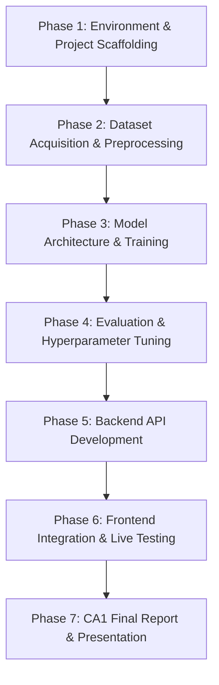

# WasteWise-AI: AI-Powered Smart Waste Classification and Intelligent Recycling System Using Deep Learning (CNN)

An individual Deep Learning Continuous Assessment (CA1) project engineered to accurately identify, classify, and guide the proper recycling and disposal of household and municipal waste using Convolutional Neural Networks (CNNs).

---

## 1. Project Overview

Improper waste management and poor sorting at source significantly contribute to environmental degradation, overburdened landfills, and reduced recycling efficiency. **WasteWise-AI** addresses this challenge by deploying deep learning computer vision models to automate waste classification directly from digital imagery. 

Beyond classification, the system pairs classification outputs with actionable, context-aware recycling guidelines to assist consumers and municipal facilities in sustainable waste disposal decisions.

---

## 2. Key Objectives

- **Automated Visual Waste Classification**: Train high-accuracy Convolutional Neural Network (CNN) models capable of categorizing waste items into key waste categories (e.g., *Plastic*, *Paper*, *Cardboard*, *Glass*, *Metal*, and *Trash/Organic*).
- **Comparative Model Benchmarking**: Implement and rigorously benchmark custom CNN baseline architectures against state-of-the-art Transfer Learning backbones (e.g., MobileNetV2, EfficientNetB0).
- **Comprehensive Evaluation**: Analyze performance using standard classification metrics including Accuracy, Precision, Recall, F1-Score, Loss curves, and Confusion Matrices.
- **Intelligent Recycling Guidance**: Map visual classifications to practical, structured recycling and handling instructions.
- **Full-Stack Deployment Pipeline**: Package the trained model into a modular backend API service paired with a clean, responsive frontend client for real-time inference.

---

## 3. Proposed Technology Stack

| Layer | Technologies | Rationale |
| :--- | :--- | :--- |
| **Language & Runtime** | Python 3.11.9 (Windows) | Modern, stable, high-performance Python runtime |
| **Deep Learning** | TensorFlow / Keras (>=2.15) | Industry-standard framework for CNN modeling & transfer learning |
| **Data & Scientific Computing** | NumPy (<2.0.0), Pandas | Efficient array manipulation and tabular dataset metadata management |
| **Preprocessing & Metrics** | scikit-learn, Pillow (PIL) | Robust data splits, image manipulation, and evaluation metrics |
| **Visualization** | Matplotlib, Seaborn | Training curves, EDA distributions, and confusion matrices |
| **Exploration & Prototyping** | Jupyter Notebooks (`ipykernel`) | Interactive experimentation and model evaluation |
| **Backend API** | FastAPI / Uvicorn | Lightweight, asynchronous, high-throughput REST API |
| **Frontend Client** | HTML5, Modern CSS, JavaScript | Interactive, responsive web UI for image upload & live prediction |
| **Version Control & CI** | Git & GitHub | Systematic source control and milestone tracking |

---

## 4. Repository Structure

```text
WasteWise-AI/
├── .gitignore               # Excludes .venv, raw datasets, models, cache, and secrets
├── requirements.txt         # Pinned ML dependencies compatible with Python 3.11
├── README.md                # Project documentation, architecture, and roadmap
│
├── ml/                      # Machine Learning pipeline
│   ├── data/                # Dataset directory (raw and processed images; git-ignored)
│   ├── notebooks/           # Jupyter notebooks for EDA, prototyping, and training
│   ├── scripts/             # Modular Python scripts for preprocessing, training, and evaluation
│   └── outputs/             # Exported models, checkpoints, and evaluation plots (git-ignored)
│
├── backend/                 # Backend API service
│   ├── app/                 # FastAPI application routes and configuration
│   ├── services/            # Inference engine, image processing, and recycling recommendations
│   └── tests/               # Backend unit and integration test suite
│
└── frontend/                # Web user interface for end-user interaction and image upload
```

---

## 5. Development Roadmap



### Phase 1: Environment & Project Scaffolding (Current)
- [x] Configure clean directory hierarchy (`ml/`, `backend/`, `frontend/`).
- [x] Set up environment-safe `.gitignore` (safeguarding models, data, and `.venv`).
- [x] Establish Python 3.11 dependency specifications in `requirements.txt`.
- [x] Author core project documentation and architecture blueprint.

### Phase 2: Dataset Acquisition & Preprocessing
- [ ] Select and acquire standard waste classification dataset (e.g., TrashNet or Kaggle Waste Classification dataset).
- [ ] Conduct Exploratory Data Analysis (EDA) on class balance, image dimensions, and visual variance.
- [ ] Build preprocessing and data augmentation pipelines (rotation, flipping, zooming, normalization).
- [ ] Implement stratified training, validation, and test splits.

### Phase 3: CNN Architecture Design & Baseline Modeling
- [ ] Build a custom CNN baseline model (Conv2D, MaxPooling2D, BatchNormalization, Dropout).
- [ ] Implement Transfer Learning candidates (e.g., MobileNetV2, EfficientNetB0) with pre-trained ImageNet weights.
- [ ] Establish checkpointing, early stopping, and learning rate scheduling callbacks.

### Phase 4: Model Evaluation, Fine-Tuning & Diagnostic Visualization
- [ ] Compare validation/test accuracy, loss, precision, recall, and macro/weighted F1-scores.
- [ ] Generate confusion matrices and per-class error distribution plots.
- [ ] Perform fine-tuning on top layers of the best-performing transfer learning model.
- [x] Export optimized model artifact (`.keras` / `.h5`).

### Phase 5: Backend API Development
- [x] Build FastAPI server with health check and prediction endpoints (`/api/v1/predict`).
- [x] Implement image validation, resizing, and normalization in service layer matching training preprocessing.
- [x] Create response schema delivering predicted class, confidence score, all six class probabilities, and structured recycling guidelines.
- [x] Write automated tests for API endpoints (`backend/tests/`).

### Phase 6: Frontend Integration & End-to-End Testing
- [x] Develop responsive interface supporting drag-and-drop image upload, file selection, and preview.
- [x] Connect frontend to backend prediction endpoint with asynchronous requests.
- [x] Display visual classification results, confidence meters, six animated recycling bins, and actionable disposal tips.
- [x] Add session statistics and recent classification history with non-guarantee notices.
- [x] Implement sub-60% confidence caution alert and municipal disclaimers.

### Phase 7: CA1 Submission & Final Documentation
- [ ] Compile experimental logs, training graphs, and metric comparison tables.
- [ ] Document final architecture, ethical considerations, and real-world deployment challenges.
- [ ] Finalize code cleanup, reproducibility checks, and project submission.

---

## 6. Getting Started

### 6.1 Prerequisites
- **Operating System**: Windows 10 / 11
- **Python**: Version `3.11.9`
- **Node.js**: Version `>= 18.x` (tested on Node v24.19.0)
- **Virtual Environment**: `.venv` (already created in workspace root)

### 6.2 Python Virtual Environment & Backend Setup
Activate your virtual environment and install dependencies:

**PowerShell (Windows):**
```powershell
.\.venv\Scripts\Activate.ps1
python -m pip install --upgrade pip
pip install -r requirements.txt
```

**Command Prompt (cmd.exe):**
```cmd
.\.venv\Scripts\activate.bat
python -m pip install --upgrade pip
pip install -r requirements.txt
```

### 6.3 Verifying Backend Environment & Tests
Run automated test suite for the FastAPI backend:
```powershell
pytest backend/tests -v
```

### 6.4 Launching the FastAPI Backend API
Start the backend inference server with Uvicorn:
```powershell
uvicorn backend.app.main:app --host 127.0.0.1 --port 8000 --reload
```
- **Base API**: [http://127.0.0.1:8000](http://127.0.0.1:8000)
- **Interactive Swagger Documentation**: [http://127.0.0.1:8000/docs](http://127.0.0.1:8000/docs)
- **Health Check Endpoint**: [http://127.0.0.1:8000/health](http://127.0.0.1:8000/health)

### 6.5 Setting Up & Launching the React Frontend
Open a new terminal window to install dependencies and run the frontend client:

```powershell
# Navigate into the frontend directory
cd frontend

# Install Node dependencies (React, Vite, Tailwind CSS, Framer Motion, Vitest)
npm install

# Start the Vite development server
npm run dev
```

The frontend will start at **[http://127.0.0.1:5173](http://127.0.0.1:5173)**.

#### Frontend Commands:
- `npm run dev`: Launch local Vite dev server with hot-module replacement.
- `npm run build`: Compile and minify production assets into `frontend/dist/`.
- `npm test`: Run automated Vitest unit tests for the frontend API client and components.
- `npm run preview`: Preview the production build locally.

### 6.6 End-to-End Workflow & Verification
1. Launch the backend API on port `8000`: `uvicorn backend.app.main:app --host 127.0.0.1 --port 8000 --reload`
2. Launch the frontend on port `5173`: `cd frontend && npm run dev`
3. Open `http://127.0.0.1:5173` in your browser.
4. Verify the top navbar displays the green **"Inference Ready"** health badge.
5. Drag and drop or browse any JPG or PNG waste image (e.g. from `ml/data/trashnet/`).
6. Click **"Classify Waste & Get Guidance"**.
7. Observe the matching animated recycling bin highlight with an open lid, confidence percentage bar, class probabilities distribution, and actionable municipal preparation tips.

