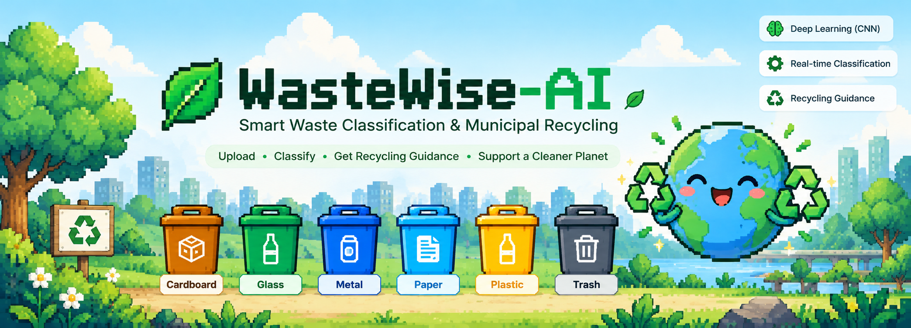
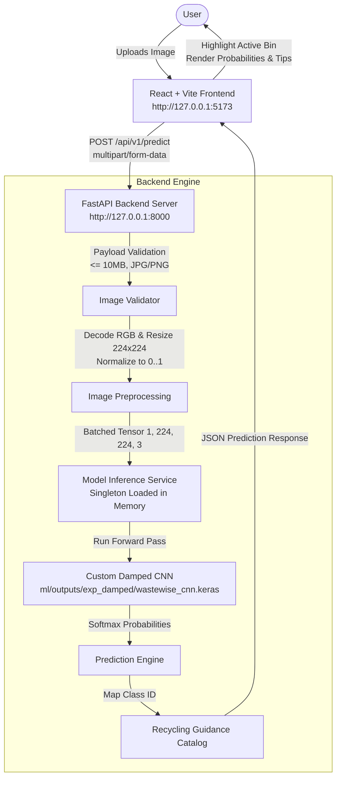

<div align="center">

# WasteWise-AI

### AI-Powered Smart Waste Classification and Intelligent Recycling System Using Deep Learning (CNN)

*Empowering automated waste sorting and contamination reduction through real-time computer vision and intelligent disposal guidance.*

[](https://www.python.org/) [](https://www.tensorflow.org/) [](https://fastapi.tiangolo.com/) [](https://react.dev/) [](https://vitejs.dev/) [](https://tailwindcss.com/) [](#testing) [](#testing) [](#license)

<p align="center">
  <strong>WasteWise-AI</strong> is an end-to-end computer vision and intelligent recycling web application engineered to automate household and municipal waste sorting. Powered by a custom Convolutional Neural Network (CNN) trained with a controlled square-root damped class-weighting schedule, WasteWise-AI classifies visual imagery into six waste streams—<strong>cardboard</strong>, <strong>glass</strong>, <strong>metal</strong>, <strong>paper</strong>, <strong>plastic</strong>, and <strong>trash</strong>—and translates predictions into actionable, material-specific preparation instructions and bin recommendations.
</p>

</div>

---

## Table of Contents

- [Project Title and Introduction](#wastewise-ai)
- [Project Overview](#project-overview)
- [Key Features](#key-features)
- [Application Screenshots](#application-screenshots)
- [System Architecture](#system-architecture)
- [Deep Learning Model](#deep-learning-model)
  - [Model Architecture](#model-architecture)
  - [Preprocessing Pipeline](#preprocessing-pipeline)
  - [Dataset & Class Mapping](#dataset--class-mapping)
  - [Damped Class-Weighting Experiment](#damped-class-weighting-experiment)
- [Model Performance](#model-performance)
  - [Overall Test Metrics](#overall-test-metrics)
  - [Per-Class Metrics](#per-class-metrics)
  - [Evaluation Context & Scope](#evaluation-context--scope)
- [Technology Stack](#technology-stack)
- [Project Structure](#project-structure)
- [Installation and Local Setup](#installation-and-local-setup)
  - [Prerequisites](#prerequisites)
  - [1. Clone Repository & Setup Python Virtual Environment](#1-clone-repository--setup-python-virtual-environment)
  - [2. Backend Setup & Verification](#2-backend-setup--verification)
  - [3. Frontend Setup & Verification](#3-frontend-setup--verification)
  - [4. Running the Full Stack Application](#4-running-the-full-stack-application)
- [API Documentation](#api-documentation)
  - [Health Check (`GET /health`)](#1-health-check-get-health)
  - [Predict Waste (`POST /api/v1/predict`)](#2-predict-waste-post-apiv1predict)
- [Testing](#testing)
- [Limitations and Future Improvements](#limitations-and-future-improvements)
- [Contributing](#contributing)
- [License](#license)
- [Author and Links](#author-and-links)

---

## Project Overview

Improper waste management, consumer sorting ambiguity, and contamination of recycling streams present major operational bottlenecks for material recovery facilities (MRFs) and municipal recycling programs. When non-recyclables or contaminated items are deposited into recycling bins, entire batches are frequently redirected to landfills or incinerators.

**WasteWise-AI** addresses this bottleneck by providing an accessible, real-time visual classification interface that guides users at the exact moment of disposal:

```text
[User Photo] ──> [Image Preprocessing] ──> [Custom CNN Model] ──> [Prediction + Confidence] ──> [Recycling Guidance]
```

1. **User Interaction**: Users capture or upload an image of a waste item via a modern web interface.
2. **Inference Pipeline**: A FastAPI backend validates and standardizes the image (224 &times; 224 RGB, $[0.0, 1.0]$ normalization) before passing it to an in-memory trained CNN.
3. **Intelligent Guidance**: The prediction is mapped to a dedicated recycling stream with actionable preparation steps (e.g., rinsing residue, flattening boxes, separating lids).
4. **Visual Feedback**: The React client displays class probabilities, sounds visual cues, highlights the matching recycling bin with an open-lid animation, and tracks session-based classification counts.

---

## Key Features

- **Interactive Drag-and-Drop Image Uploader**: Allows users to drag-and-drop or browse JPG, JPEG, and PNG images, featuring instantaneous client-side previews, file-type verification, and image clearing.
- **Six-Class Deep Learning Classification**: Categorizes items into `cardboard`, `glass`, `metal`, `paper`, `plastic`, and `trash` using a custom-trained CNN.
- **Class Probabilities & Confidence Distribution**: Displays the top predicted category alongside probability meters for all six classes, offering transparency into model certainty.
- **Low-Confidence Caution Safeguard**: Dynamically flags classifications with confidence scores below 60%, warning users that the object is visually ambiguous and advising manual verification.
- **Actionable Recycling Bin Guidance**: Delivers step-by-step instructions per category (such as rinsing greasy food containers, keeping paper dry, and detaching non-paper components).
- **Animated Recycling Bin Highlighting**: Features six distinct, color-coded recycling bins with smooth Framer Motion animations that lift the bin lid and highlight borders upon prediction.
- **Client Session Statistics & History**: Keeps an active browser session counter (Total Scanned, Recyclables, Trash) and an interactive carousel of recent items with fallback thumbnail handling (*client-side session counts only; not physical waste tracking*).
- **Input Validation & Error Handling**: Server-side validation rejecting unsupported formats, files larger than 10 MB, or corrupt images with descriptive JSON error responses.

---

## Application Screenshots

> **Adding Screenshots**: Save your application screenshots to the relative paths below to display them here:
> - `docs/images/dashboard.png` — Main dashboard view with image uploader and recycling bins.
> - `docs/images/prediction-result.png` — Classification result with probability meters and guidance.

```markdown
<!-- Dashboard View -->


<!-- Prediction Result & Recycling Guidance -->

```

*(If images are not yet added to `docs/images/`, the relative links above will activate automatically once the screenshot files are placed in that directory.)*

---

## System Architecture

The application is structured into a modular, decoupled full-stack architecture:



---

## Deep Learning Model

### Model Architecture

WasteWise-AI employs a custom Convolutional Neural Network designed for balanced feature extraction and strong regularization on medium-sized image datasets:

- **Input Layer**: Takes standard 3-channel RGB images resized to $224 \times 224$ pixels, normalized to float values in $[0.0, 1.0]$.
- **Convolutional Blocks (4 Blocks)**:
  - **Block 1**: 2 &times; `Conv2D(32, (3, 3), padding="same")` $\rightarrow$ `BatchNormalization` $\rightarrow$ `ReLU` $\rightarrow$ `MaxPooling2D(2, 2)` $\rightarrow$ `Dropout(0.20)`
  - **Block 2**: 2 &times; `Conv2D(64, (3, 3), padding="same")` $\rightarrow$ `BatchNormalization` $\rightarrow$ `ReLU` $\rightarrow$ `MaxPooling2D(2, 2)` $\rightarrow$ `Dropout(0.25)`
  - **Block 3**: 2 &times; `Conv2D(128, (3, 3), padding="same")` $\rightarrow$ `BatchNormalization` $\rightarrow$ `ReLU` $\rightarrow$ `MaxPooling2D(2, 2)` $\rightarrow$ `Dropout(0.30)`
  - **Block 4**: 1 &times; `Conv2D(256, (3, 3), padding="same")` $\rightarrow$ `BatchNormalization` $\rightarrow$ `ReLU` $\rightarrow$ `MaxPooling2D(2, 2)` $\rightarrow$ `Dropout(0.35)`
- **Classification Head**:
  - `GlobalAveragePooling2D()`: Replaces dense flattening to drastically reduce parameter count and mitigate spatial overfitting.
  - `Dense(256)` $\rightarrow$ `BatchNormalization` $\rightarrow$ `ReLU` $\rightarrow$ `Dropout(0.50)`
  - `Dense(6, activation="softmax")`: Outputs class probabilities for the six target classes.
- **Parameters**: 653,350 total parameters (651,430 trainable; 1,920 non-trainable batch normalization parameters).

### Preprocessing Pipeline

1. **Decoding**: Images are decoded as 3-channel RGB (converting grayscale or stripping alpha channels).
2. **Resizing**: Bilinear interpolation resizing to $224 \times 224$ pixels.
3. **Scaling**: Pixel intensity cast to `float32` and scaled to $[0.0, 1.0]$ via $x / 255.0$.
4. **Data Augmentation** (*training partition only*): Random horizontal flipping, subtle rotation ($\pm 5\%$), and subtle zoom ($\pm 10\%$).

### Dataset & Class Mapping

The model was trained and evaluated on the **TrashNet** dataset (Gary Thung & Mindy Yang, Stanford University), consisting of 2,527 studio-lit single-object waste photographs divided into six distinct categories:

| Class ID | Class Name | Total Samples | Train Split (70%) | Validation Split (15%) | Test Split (15%) |
| :---: | :--- | :---: | :---: | :---: | :---: |
| `0` | `cardboard` | 403 | 282 | 61 | 60 |
| `1` | `glass` | 501 | 350 | 75 | 76 |
| `2` | `metal` | 410 | 287 | 61 | 62 |
| `3` | `paper` | 594 | 416 | 89 | 89 |
| `4` | `plastic` | 482 | 337 | 72 | 73 |
| `5` | `trash` | 137 | 96 | 21 | 20 |
| **Total** | | **2,527** | **1,768** | **379** | **380** |

All splits were stratified to ensure representative class distributions across partitions.

### Damped Class-Weighting Experiment

The baseline model trained with standard inverse-frequency class weights suffered from severe over-prediction of the minority `trash` class (only 96 training examples vs. 416 for paper). While recall for trash reached 95%, precision collapsed to 34.55%, causing widespread false alarms on recyclable plastic and cardboard.

To counter this, a controlled experiment evaluated **square-root dampened class weights**:

$$w_k = C \cdot \frac{\frac{1}{\sqrt{N_k}}}{\sum_{j=1}^{C} \frac{1}{\sqrt{N_j}}}$$

Where $C = 6$ is the number of classes and $N_k$ is the number of training samples in class $k$:

| Class Name | Train Samples ($N_k$) | Standard Weight | Damped Weight ($w_k$) |
| :--- | :---: | :---: | :---: |
| `cardboard` | 282 | 1.0449 | **0.9462** |
| `glass` | 350 | 0.8419 | **0.8494** |
| `metal` | 287 | 1.0267 | **0.9380** |
| `paper` | 416 | 0.7083 | **0.7791** |
| `plastic` | 337 | 0.8744 | **0.8656** |
| `trash` | 96 | 3.0694 | **1.6218** |

**Experimental Finding**: Square-root dampening reduced the disproportionate loss penalty on trash false negatives. This improved minority class precision from 34.55% to 50.00% while elevating overall test accuracy to 71.58% and macro F1-score to 69.92%.

---

## Model Performance

The performance metrics below are recorded directly from the verified evaluation run on the **held-out test partition of 380 images** (`ml/outputs/exp_damped/test_metrics.json`):

### Overall Test Metrics

| Metric | Value |
| :--- | :---: |
| **Test Accuracy** | **71.58%** (272 / 380 correct) |
| **Test Categorical Cross-Entropy Loss** | **0.8118** |
| **Macro Average Precision** | **69.28%** |
| **Macro Average Recall** | **71.62%** |
| **Macro Average F1-Score** | **69.92%** |
| **Weighted Average F1-Score** | **71.64%** |
| **Test Support** | **380 images** |

### Per-Class Metrics

| Category | Class ID | Test Support | Precision | Recall | F1-Score |
| :--- | :---: | :---: | :---: | :---: | :---: |
| **Cardboard** | `0` | 60 | 80.30% | 88.33% | 84.13% |
| **Glass** | `1` | 76 | 76.27% | 59.21% | 66.67% |
| **Metal** | `2` | 62 | 60.29% | 66.13% | 63.08% |
| **Paper** | `3` | 89 | 82.14% | 77.53% | 79.77% |
| **Plastic** | `4` | 73 | 66.67% | 68.49% | 67.57% |
| **Trash** | `5` | 20 | 50.00% | 70.00% | 58.33% |
| **Macro Average** | — | **380** | **69.28%** | **71.62%** | **69.92%** |
| **Weighted Average** | — | **380** | **72.45%** | **71.58%** | **71.64%** |

### Evaluation Context & Scope

- **Evaluation Partition**: Metrics are computed exclusively on an uncorrupted held-out test split of 380 images that the model never encountered during training or validation.
- **Academic Benchmark**: These results represent classification performance on single-item studio photographs from TrashNet. The model is an educational and exploratory prototype; it is **not rated for commercial or automated industrial sorting facilities**.

---

## Technology Stack

### Machine Learning & Data Pipeline
- **Python 3.11.9**: Base runtime environment.
- **TensorFlow / Keras 2.16.x**: Neural network design, data pipelines (`tf.data`), and training routines.
- **NumPy (< 2.0.0)** & **Pandas**: Tabular manifest management, array processing, and class-weight calculations.
- **scikit-learn**: Stratified dataset splitting and classification metrics calculation.
- **Pillow (PIL)**: Image decoding and preprocessing verification.
- **Matplotlib & Seaborn**: Training curves and confusion matrix visualization.

### Backend API
- **FastAPI 0.115.6**: Asynchronous, high-performance REST API.
- **Uvicorn (standard)**: ASGI server implementation for local hosting.
- **Pydantic v2**: Strict schema validation for request payloads and response contracts.
- **python-multipart**: Multipart/form-data upload parsing.

### Frontend Client
- **React 18.3.1**: Component-driven user interface.
- **Vite 5.4.11**: Fast frontend build tooling and local development server.
- **Tailwind CSS 3.4.15**: Modern utility-first styling with an eco-tech green/white palette.
- **Framer Motion 11.11.17**: Micro-animations for bin opening and card transitions.
- **Lucide React**: Clean iconography for categories, status badges, and action buttons.
- **Canvas Confetti**: Visual celebration trigger for high-confidence recyclable classifications.

### Testing & Quality Assurance
- **Pytest 8.x & HTTPX**: Automated backend unit and integration test suite (24 tests).
- **Vitest 2.1.9**: Automated frontend unit tests for API integration, image preview, and components (12 tests).

---

## Project Structure

```text
WasteWise-AI/
├── .gitignore                    # Excludes .venv, raw datasets, models, cache, and secrets
├── requirements.txt              # Pinned Python dependencies for ML and FastAPI
├── pytest.ini                   # Pytest test discovery and warning configurations
├── README.md                     # Comprehensive project documentation
│
├── ml/                           # Machine Learning pipeline
│   ├── notebooks/                # Exploratory notebooks (.gitkeep)
│   ├── scripts/                  # Reproducible ML scripts
│   │   ├── prepare_dataset.py    # Stratified split manifest generator (70/15/15)
│   │   └── train_cnn.py          # Custom CNN training, evaluation & metrics exporter
│   └── outputs/                  # Model artifacts and metrics
│       ├── class_weights_damped.json   # Square-root damped class weights
│       └── exp_damped/                 # Verified damped CNN experiment artifacts
│           ├── class_mapping.json      # 6-class bidirectional mapping
│           ├── confusion_matrix.png    # Test set confusion matrix plot
│           ├── test_metrics.json       # Verified accuracy (71.58%) and per-class scores
│           ├── training_curves.png     # Loss and accuracy curves over epochs
│           ├── training_history.csv    # Per-epoch loss/accuracy metrics log
│           └── wastewise_cnn.keras     # Trained CNN model artifact (in .gitignore)
│
├── backend/                      # FastAPI Backend service
│   ├── app/                      # Application core
│   │   ├── config.py             # Settings, paths, upload limits (10MB)
│   │   ├── main.py               # FastAPI entry point and routes
│   │   └── schemas.py            # Pydantic request/response schemas
│   ├── services/                 # Business logic
│   │   ├── model_service.py      # Preprocessing (224x224 RGB [0,1]) & singleton inference
│   │   └── recycling_service.py  # Recycling recommendations & municipal disclaimer
│   └── tests/                    # Backend automated tests (24 passed)
│       ├── test_api.py           # Integration tests for /health, /predict, and validation
│       └── test_model_service.py # Unit tests for preprocessing and inference
│
└── frontend/                     # React + Vite frontend client
    ├── package.json              # Frontend scripts and dependencies
    ├── vite.config.js            # Vite configuration with React plugin
    ├── tailwind.config.js        # Tailwind design tokens and color theme
    ├── src/
    │   ├── App.jsx               # Root layout, session stats, and workflow coordinator
    │   ├── main.jsx              # Application bootstrap
    │   ├── index.css             # Base styles and Inter typography
    │   ├── components/           # Modular UI components
    │   │   ├── Header.jsx        # Navigation bar and live backend health badge
    │   │   ├── ImageUploader.jsx # Drag-and-drop file upload with live preview
    │   │   ├── PredictionResult.jsx # Confidence meter, 6 probability bars & guidance
    │   │   ├── RecyclingBins.jsx # 6 animated, color-coded recycling bins
    │   │   └── HistoryList.jsx   # Session-based classification history cards
    │   ├── services/
    │   │   └── api.js            # Frontend API client for /health and /predict
    │   └── tests/                # Frontend automated tests (12 passed)
    │       ├── api.test.js
    │       ├── recyclingBins.test.js
    │       └── thumbnail.test.js
```

---

## Installation and Local Setup

### Prerequisites

- **Operating System**: Windows 10 / 11 (or macOS / Linux with corresponding shell syntax)
- **Python**: Version `3.11.x`
- **Node.js**: Version `>= 18.x` (tested on Node v24.19.0)
- **Git**: Installed and configured on your system

---

### 1. Clone Repository & Setup Python Virtual Environment

Open a terminal (PowerShell on Windows) and clone the repository:

```powershell
git clone https://github.com/bprasad03/WasteWise-AI.git
cd WasteWise-AI
```

Create and activate a Python 3.11 virtual environment:

**PowerShell (Windows):**
```powershell
python -m venv .venv
.\.venv\Scripts\Activate.ps1
```

**Command Prompt (cmd.exe):**
```cmd
python -m venv .venv
.\.venv\Scripts\activate.bat
```

**macOS / Linux:**
```bash
python3 -m venv .venv
source .venv/bin/activate
```

---

### 2. Backend Setup & Verification

With your virtual environment active, install backend dependencies:

```powershell
python -m pip install --upgrade pip
pip install -r requirements.txt
```

Verify backend installation by running the test suite:

```powershell
.\.venv\Scripts\pytest.exe backend\tests -q
```
*(Expected output: `24 passed`)*

---

### 3. Frontend Setup & Verification

Open a separate terminal, navigate into `frontend/`, and install Node dependencies:

```powershell
cd frontend
npm install
```

Run frontend automated tests and verify the production build:

```powershell
npm test
npm run build
```
*(Expected output: `12 passed` across 3 test suites, and clean production compilation in `dist/`)*

---

### 4. Running the Full Stack Application

The backend API and frontend client run in two separate terminal windows:

#### Terminal 1: FastAPI Backend Server
From the project root directory with `.venv` activated:

```powershell
uvicorn backend.app.main:app --host 127.0.0.1 --port 8000 --reload
```
- **Base API**: [http://127.0.0.1:8000](http://127.0.0.1:8000)
- **Interactive OpenAPI Documentation (Swagger)**: [http://127.0.0.1:8000/docs](http://127.0.0.1:8000/docs)
- **Health Check Endpoint**: [http://127.0.0.1:8000/health](http://127.0.0.1:8000/health)

#### Terminal 2: React + Vite Frontend Client
From the `frontend/` directory:

```powershell
npm run dev
```
- **Local Web Application**: [http://127.0.0.1:5173](http://127.0.0.1:5173)

---

## API Documentation

### 1. Health Check (`GET /health`)

Returns the current status of the FastAPI service and verifies whether the trained CNN model is loaded into memory.

**Request:**
```http
GET /health HTTP/1.1
Host: 127.0.0.1:8000
```

**Response (`200 OK`):**
```json
{
  "status": "healthy",
  "model_loaded": true,
  "model_path": "ml/outputs/exp_damped/wastewise_cnn.keras",
  "version": "1.0.0"
}
```

---

### 2. Predict Waste (`POST /api/v1/predict`)

Accepts a waste item image, normalizes it to the CNN training dimensions ($224 \times 224$ RGB), computes class probabilities, and generates corresponding recycling guidance.

- **Content-Type**: `multipart/form-data`
- **Supported Formats**: `.jpg`, `.jpeg`, `.png`
- **File Size Limit**: Maximum 10 MB (`MAX_UPLOAD_SIZE_BYTES = 10485760`)

**Example Request (`cURL`):**
```bash
curl -X POST "http://127.0.0.1:8000/api/v1/predict" \
     -H "accept: application/json" \
     -F "file=@sample_bottle.jpg"
```

**Example Response (`200 OK`):**
```json
{
  "predicted_class": "plastic",
  "predicted_class_id": 4,
  "confidence": 0.8842,
  "probabilities": [
    { "class_id": 0, "class_name": "cardboard", "probability": 0.0125 },
    { "class_id": 1, "class_name": "glass", "probability": 0.0318 },
    { "class_id": 2, "class_name": "metal", "probability": 0.0412 },
    { "class_id": 3, "class_name": "paper", "probability": 0.0083 },
    { "class_id": 4, "class_name": "plastic", "probability": 0.8842 },
    { "class_id": 5, "class_name": "trash", "probability": 0.0220 }
  ],
  "guidance": {
    "bin_name": "Plastics & Mixed Recyclables Bin",
    "bin_color": "Yellow / Blue (Commingled)",
    "instructions": [
      "Empty liquids and rinse food residue from bottles, jugs, and tubs.",
      "Check the Resin Identification Code (numbers 1 [PET] and 2 [HDPE] are universally accepted; 3–7 depend on local facilities).",
      "Screw plastic caps back onto empty bottles if accepted by your local program.",
      "Do not place soft plastic films, plastic bags, bubble wrap, or styrofoam in curbside bins unless specially designated."
    ],
    "disclaimer": "Guidance only: Recycling rules, accepted items, and bin color coding vary by city, county, and local waste management contractor. Always check your local municipality's official waste sorting guidelines."
  },
  "filename": "sample_bottle.jpg"
}
```

**Common Error Responses:**
- `400 Bad Request`: Unsupported file extension, unsupported MIME type, empty payload, or corrupted image.
- `413 Content Too Large`: Uploaded file exceeds the 10 MB limit.
- `503 Service Unavailable`: CNN model is not loaded in memory.

---

## Testing

WasteWise-AI maintains automated test suites across both the Python backend and React frontend.

### Backend Tests (Pytest)
Tests cover health checks, valid predictions, payload size limits, invalid formats, corrupted image handling, and preprocessing consistency:

```powershell
.\.venv\Scripts\pytest.exe backend\tests -q
```
```text
........................                                                 [100%]
24 passed in 3.42s
```

### Frontend Tests (Vitest)
Tests validate API client functions, network error fallbacks, component rendering, and thumbnail cleanup:

```powershell
cd frontend
npm test
```
```text
 ✓ src/tests/thumbnail.test.js (2 tests)
 ✓ src/tests/api.test.js (8 tests)
 ✓ src/tests/recyclingBins.test.js (2 tests)

 Test Files  3 passed (3)
      Tests  12 passed (12)
```

### Production Build Verification
Ensure the frontend compiles cleanly without bundling or linting errors:

```powershell
cd frontend
npm run build
```

---

## Limitations and Future Improvements

### Current Limitations
1. **Single-Item Assumption**: The model is trained on TrashNet imagery featuring centered single items on neutral backgrounds; complex, cluttered multi-object scenes or heavy occlusions reduce classification reliability.
2. **Material Ambiguities**: Certain composite materials (e.g., waxed coffee cups, laminated cardboard, clear plastic vs. clear glass bottles) share similar visual features, leading to split prediction probabilities.
3. **Dataset Scale & Diversity**: With 2,527 images, the dataset provides a solid baseline for standard household items but lacks representation for soiled items, crushed packaging, industrial waste, or rare plastic types.
4. **Local Recycling Variance**: Municipal sorting policies vary widely (e.g., whether #5 Polypropylene is accepted curbside). The system's recommendations are general best practices and cannot account for all hyper-local guidelines.

### Future Roadmap
- **Transfer Learning Integration**: Fine-tune modern architectures such as MobileNetV3 or EfficientNet-B0 to assess improvements in feature discrimination and inference speed.
- **Object Detection & Multi-Item Parsing**: Incorporate YOLOv8 or Faster R-CNN to localize and classify multiple waste items simultaneously in a single photograph.
- **Edge Model Optimization**: Quantize the trained model via TensorFlow Lite or ONNX Runtime for low-latency inference on mobile and IoT edge devices.
- **Barcode & Packaging Symbol Recognition**: Integrate OCR to scan universal recycling symbols (Resin Identification Codes 1–7) to supplement visual CNN predictions.

---

## Contributing

Contributions, bug reports, and suggestions are welcome:

1. **Fork the repository** on GitHub.
2. **Create a feature branch**:
   ```bash
   git checkout -b feature/your-feature-name
   ```
3. **Commit your modifications**:
   ```bash
   git commit -m "Add descriptive commit message"
   ```
4. **Run backend and frontend tests** to ensure no regressions:
   ```bash
   pytest backend/tests -q
   cd frontend && npm test && npm run build
   ```
5. **Push to your branch**:
   ```bash
   git push origin feature/your-feature-name
   ```
6. **Open a Pull Request** describing your changes.

---

## License

The license for this repository has **not yet been specified**. All rights are reserved by the repository owner. Please contact the author directly regarding permissions for redistribution, commercial use, or modification.

---

## Author and Links

- **Author**: Bablu Prasad
- **GitHub Profile**: [@bprasad03](https://github.com/bprasad03)
- **Project Repository**: [https://github.com/bprasad03/WasteWise-AI](https://github.com/bprasad03/WasteWise-AI)
